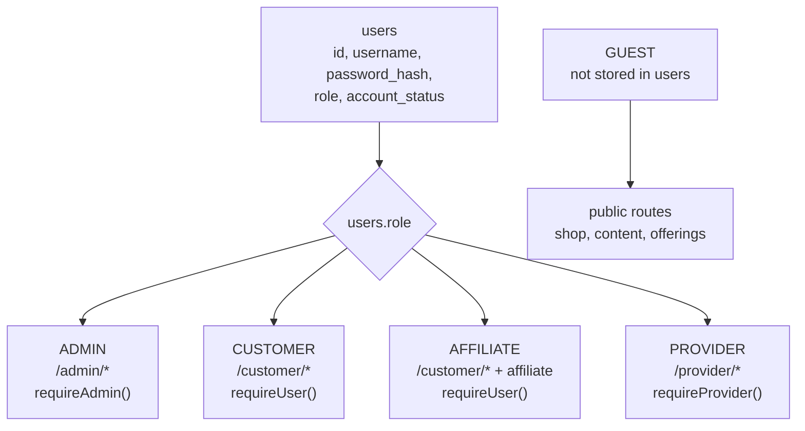
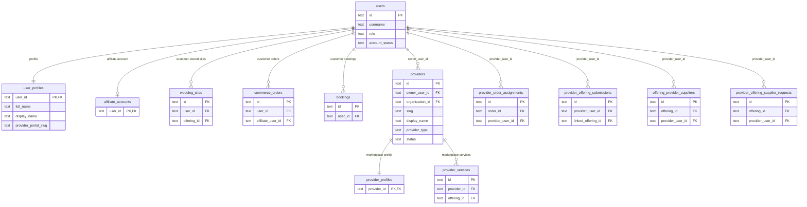
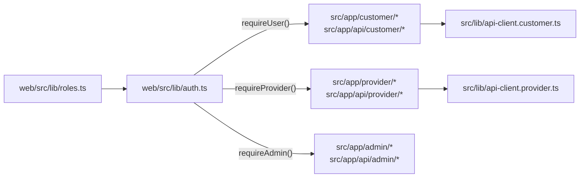

# Account, Customer, Provider Map

This note explains why the project has `users`, customer routes, provider
routes, and the `providers` marketplace entity at the same time.

Verified against:

- Runtime PostgreSQL metadata on local `app` database.
- Source schema in `web/src/lib/database.ts`.
- Auth and role code in `web/src/lib/auth.ts` and `web/src/lib/roles.ts`.

## Short Version

- `users` is the shared login/account table.
- `users.role` decides the primary portal role: `ADMIN`, `CUSTOMER`,
  `AFFILIATE`, or `PROVIDER`.
- `customer/*` is a customer workspace, not a separate account system.
- `provider/*` is a provider workspace, not a separate account system.
- `providers.id` is the marketplace/provider business entity.
- `provider_user_id` means a provider account in `users.id`.
- `provider_id` means a marketplace provider entity in `providers.id`.

## Identity And Role Flow

There is one shared login identity. The project then routes that account into
the correct protected area.

## Database Relationship Map

## Why Both `provider_user_id` And `provider_id` Exist

They are intentionally different.

| Name | Points to | Meaning | Used for |
| --- | --- | --- | --- |
| `user_id` | `users.id` | Any login account/customer owner | customer data, orders, bookings, profiles |
| `provider_user_id` | `users.id` | Authenticated provider account actor | provider portal workflows, supplier requests, assignments |
| `provider_id` | `providers.id` | Marketplace provider business entity | public profile, services, pricing, regions, reviews, search |
| `owner_user_id` | `users.id` | Account that owns a provider entity | link from provider business entity back to login account |

Rule of thumb:

- If the code asks "who is logged in and allowed to act?", use `users.id`.
- If the code asks "which provider business/profile/service is shown in the
  marketplace?", use `providers.id`.

## Source Routing Map

## Practical Examples

- Customer creates a wedding invitation:
  `wedding_sites.user_id -> users.id`.
- Customer checks out:
  `commerce_orders.user_id -> users.id`.
- Admin assigns a physical order to a provider account:
  `provider_order_assignments.provider_user_id -> users.id`.
- Provider submits a service/product for approval:
  `provider_offering_submissions.provider_user_id -> users.id`.
- Approved provider service appears in marketplace:
  `provider_services.provider_id -> providers.id`.
- Public provider profile, pricing, regions, reviews:
  use `providers.id`.

## What Not To Do

- Do not create another account table for customers or providers.
- Do not use `provider_id` when the column stores a `users.id`.
- Do not point marketplace profile/service/pricing/review ownership directly at
  `users.id`; use `providers.id`.
- Do not mix provider operational screens into `/customer/*`; provider work
  belongs in `/provider/*`.
