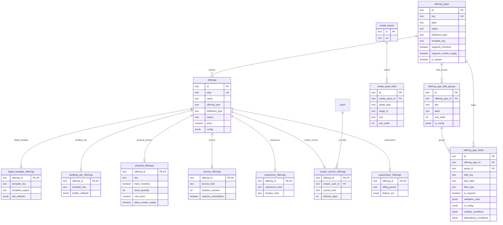
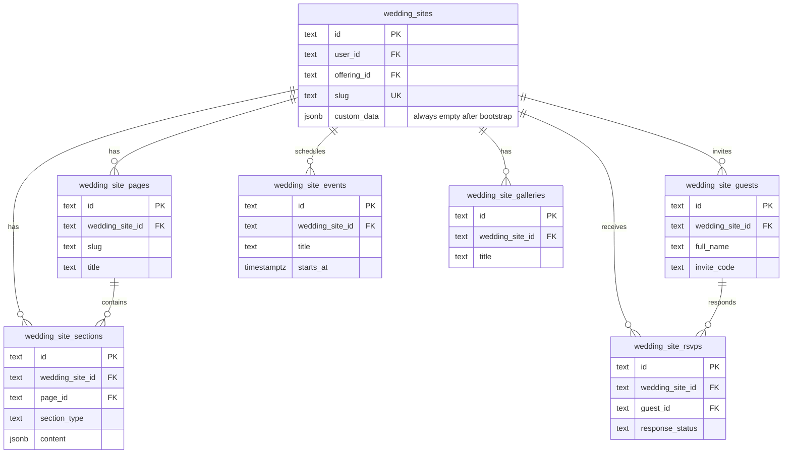
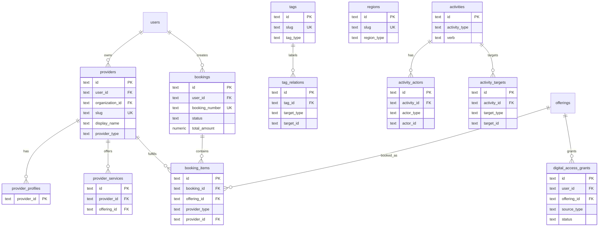
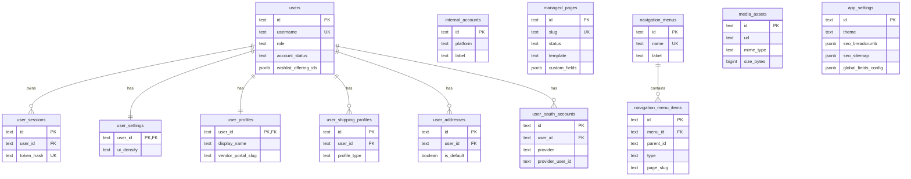
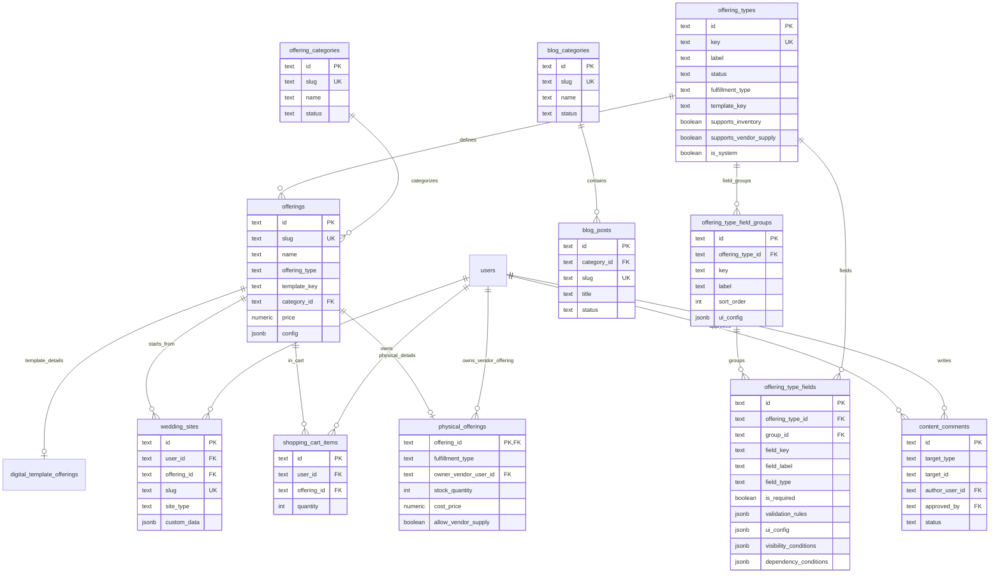
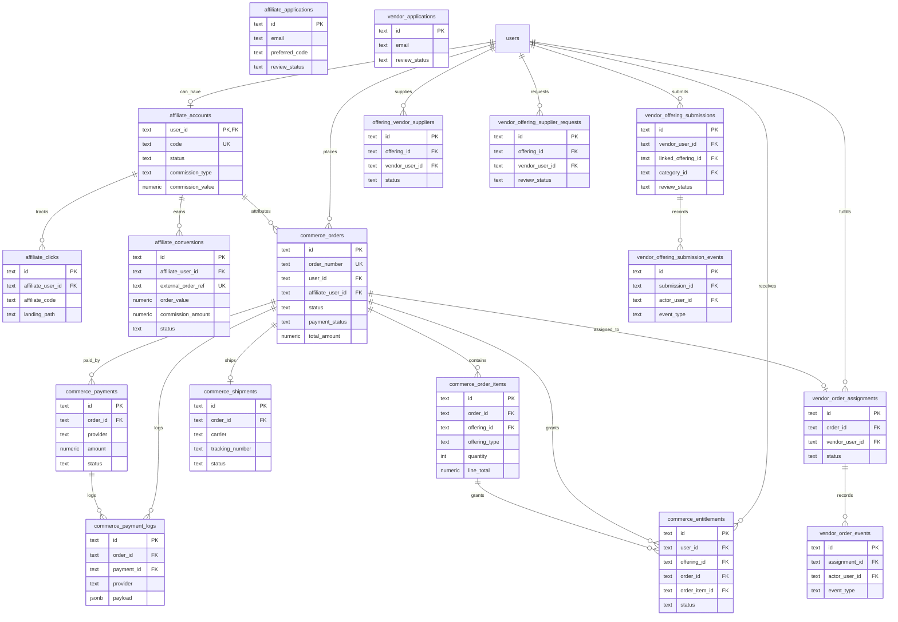

# Database Schema

Current database schema snapshot for the PinkLove project.

This file is meant to be readable directly on GitHub. GitHub renders the Mermaid
ER diagrams below, so the table map can be reviewed without opening a database
client.

Snapshot source:

- Runtime database: local Docker PostgreSQL `app`
- Schema source in code: `web/src/lib/database.ts`
- Last refreshed from DB: 2026-05-23

## ID Policy

The clean runtime schema uses `text` primary keys and foreign keys. The current
ID generator is `app_random_id()`, a nanoid-compatible 24 character text
generator. The latest DB audit returned zero `bigint`/`integer` ID columns.

## Table Count

Current database has 121 public tables:

| Area | Tables |
| --- | --- |
| Identity | `users`, `user_sessions`, `user_settings`, `user_profiles`, `user_shipping_profiles`, `user_addresses`, `user_oauth_accounts`, `internal_accounts` |
| CMS | `managed_pages`, `navigation_menus`, `navigation_menu_items`, `media_assets`, `media_asset_links`, `app_settings` |
| Affiliate | `affiliate_accounts`, `affiliate_clicks`, `affiliate_conversions`, `affiliate_applications` |
| Offerings | `offering_types`, `offering_type_field_groups`, `offering_type_fields`, `offering_categories`, `offerings`, `digital_template_offerings`, `physical_offerings`, `offering_bundles`, `offering_bundle_items`, `offering_search_documents`, `shopping_cart_items` |
| Blog / comments | `blog_categories`, `blog_posts`, `content_comments` |
| Commerce | `commerce_orders`, `commerce_order_items`, `commerce_payments`, `commerce_payment_logs`, `commerce_shipments`, `commerce_entitlements` |
| Vendors | `vendor_order_assignments`, `vendor_order_events`, `vendor_offering_submissions`, `vendor_offering_submission_events`, `offering_vendor_suppliers`, `vendor_offering_supplier_requests`, `vendor_applications` |
| Chat | `chat_conversations`, `chat_conversation_participants`, `chat_messages`, `chat_message_user_states`, `chat_conversation_user_states`, `chat_typing_states` |
| Notifications | `notifications`, `notification_target_roles`, `notification_target_users`, `notification_user_states` |
| Offering domain extensions | `digital_template_offerings`, `physical_offerings`, `wedding_site_offerings`, `service_offerings`, `creator_service_offerings`, `experience_offerings`, `subscription_offerings` |
| Wedding experience | `wedding_site_pages`, `wedding_site_sections`, `wedding_site_guests`, `wedding_site_rsvps`, `wedding_site_events`, `wedding_site_galleries` |
| Provider ecosystem | `providers`, `provider_profiles`, `provider_services`, `provider_regions`, `provider_reviews`, `provider_pricing`, `provider_fulfillments`, `provider_types` |
| Service booking | `bookings`, `booking_items`, `booking_status_logs`, `booking_payments`, `booking_calendars`, `provider_availability`, `provider_time_slots` |
| Digital access | `digital_access_grants`, `subscription_access`, `feature_access` |
| Organizations | `organizations`, `organization_members`, `organization_roles` |
| Template discovery | `template_collections`, `template_variants`, `template_tags`, `template_styles`, `template_categories`, `template_attributes`, `template_attribute_values`, `template_analytics`, `template_views`, `template_shares`, `template_conversions`, `template_engines` |
| Taxonomy / activity / regions | `tags`, `tag_relations`, `activities`, `activity_actors`, `activity_targets`, `domain_events`, `domain_event_types`, `analytics_sessions`, `analytics_page_views`, `analytics_events`, `regions`, `shipping_regions`, `service_regions` |
| System config / constraints | `offering_statuses`, `media_target_types`, `media_roles` |
| SEO / audit | `seo_redirects`, `seo_metadata`, `seo_indexing_rules`, `field_change_logs` |

## Core Refactor Status

The sellable catalog source of truth is `offerings`. The older product naming
has been removed from the application surface and new catalog work should not
create `products` tables, routes, services, or API names.

The final roadmap lives in `docs/architecture-todo.md`. This schema document
tracks the runtime database plus the next target shape when the runtime has
known transitional tables.

Offering types are data-driven through `offering_types`:

- `offerings.offering_type` stores the type key.
- `offering_types.key` defines available type keys, labels, fulfillment behavior,
  and inventory/vendor flags.
- Relational `offering_type_fields` rows are the source of truth for admin field
  definitions.
- `offering_types.field_schema` has been removed from the clean runtime schema.
- Custom type-specific values are stored under `offerings.config.customFields`.
- `offerings.config` is guarded as lightweight UI/metadata storage only. The
  database boundary rejects `inventory`, `pricing_rules`, `permissions`,
  `analytics`, `booking_logic`, `relational_data`, `siteDefaults`,
  `generalOffering`, and `vendorSupply`.
- Physical inventory, cost, vendor ownership, and vendor supply flags live in
  `physical_offerings`, not in `offerings.config`.
- A new type such as `video_invitation` or `creator_service` can be created from
  `/admin/offerings/types` without adding a new table or hardcoded union.
- Add a dedicated subtype table only when a domain needs strongly queried,
  relational columns at scale.

Runtime now uses business-domain offering tables. Implementation-based subtype
tables have been removed. Coded/builder behavior is stored as rendering strategy
through `template_engine` and `template_mode`, not as product type.

Current domain tables:

- `digital_template_offerings`
- `physical_offerings`
- `service_offerings`
- `creator_service_offerings`
- `experience_offerings`
- `subscription_offerings`

Current offering type keys:

- `digital_template`
- `physical_product`
- `service`
- `creator_service`
- `experience`
- `subscription`
- `addon`

Field definitions are relational `offering_type_fields` rows grouped by
`offering_type_field_groups`. Admin offering create/edit forms read these rows
directly, render grouped dynamic field sections, apply visibility conditions,
and validate custom values before writing `offerings.config.customFields`.

The clean schema includes the provider, bundle, availability, search document,
organization, domain event, template attribute, and analytics tables from the
final architecture checklist.

Config tables seed controlled values for `provider_types`, `template_engines`,
`offering_statuses`, `media_target_types`, `media_roles`, and
`domain_event_types`. This keeps admin forms extensible without allowing random
provider types, media targets, media roles, template engines, or cache
invalidation event names.

Current runtime seed data:

| Type key | Label | Status | Fulfillment | Template key | Inventory | Vendor supply | System | Fields |
| --- | --- | --- | --- | --- | --- | --- | --- | ---: |
| `addon` | Addon | active | digital | `addon` | no | no | yes | 0 |
| `creator_service` | Creator Service | active | service | `creator_service` | no | yes | yes | 0 |
| `digital_template` | Digital Template | active | digital | `digital_template` | no | no | yes | 0 |
| `experience` | Experience | active | service | `experience` | no | yes | yes | 0 |
| `physical_product` | Physical Product | active | physical | `physical_product` | yes | yes | yes | 0 |
| `service` | Service | active | service | `service` | no | yes | yes | 0 |
| `subscription` | Subscription | active | digital | `subscription` | no | no | yes | 0 |

Current runtime offering data:

| Offering type | Template engine | Rows |
| --- | --- | ---: |
| `digital_template` | `builder` | 6 |
| `digital_template` | `coded` | 6 |
| `physical_product` | none | 6 |

## Final Cleanup Runtime Contracts

- ID columns are text-only. User references, menu references, affiliate
  references, chat references, vendor fulfillment references, and
  `app_settings.id` have all been migrated away from `bigint`/`integer` IDs.
- Provider types are controlled by `provider_types`; current seeded values are
  `vendor`, `creator`, `studio`, `planner`, `photographer`, `makeup`,
  `florist`, and `videographer`.
- Template rendering strategy is controlled by `template_engines`; current
  seeded values are `coded`, `builder`, `hybrid`, `motion`, `video`, and
  `ai_generated`.
- Offering moderation status is controlled by `offering_statuses`; current
  seeded values are `draft`, `pending_review`, `published`, `archived`, and
  `disabled`.
- Media link constraints are backed by `media_target_types` and `media_roles`.
  The runtime accepts targets such as `offering`, `provider`, `wedding_site`,
  `gallery`, `booking`, `organization`, and `template`.
- `offering_search_documents.search_vector` is a generated PostgreSQL
  `tsvector` with a GIN index for full-text search.
- `field_change_logs` stores auditable field changes across modules.
- `seo_redirects`, `seo_metadata`, and `seo_indexing_rules` hold SEO domain
  state outside generic JSON settings.
- Admin redirect management and runtime redirect lookup use `seo_redirects`;
  legacy `app_settings.seo_redirects` is only a fallback/backfill source.
- `domain_event_types` declares canonical event names and marks cache
  invalidation events such as `offering.updated`, `template.updated`,
  `provider.updated`, and `site.published`.
- Vendor-prefixed fulfillment tables remain intentionally as the physical
  fulfillment domain. Provider-facing marketplace identity lives in
  `providers` and `provider_*` tables.

## Overview

```mermaid
erDiagram
  users ||--o{ user_sessions : owns
  users ||--o{ user_profiles : has
  users ||--o{ offerings : vendor_owns
  users ||--o{ offerings : owns
  users ||--o{ wedding_sites : creates
  users ||--o{ commerce_orders : places
  users ||--o| affiliate_accounts : can_have
  users ||--o{ chat_conversations : participates
  users ||--o{ notifications : receives

  offering_categories ||--o{ offerings : categorizes
  offering_types ||--o{ offerings : defines
  offering_types ||--o{ offering_type_field_groups : field_groups
  offering_types ||--o{ offering_type_fields : fields
  offering_type_field_groups ||--o{ offering_type_fields : groups
  offerings ||--o| digital_template_offerings : has
  offerings ||--o| wedding_site_offerings : has
  offerings ||--o| physical_offerings : has
  offerings ||--o| service_offerings : has
  offerings ||--o| creator_service_offerings : has
  offerings ||--o| subscription_offerings : has
  offerings ||--o| experience_offerings : has
  offerings ||--o{ media_asset_links : media
  offerings ||--o{ wedding_sites : creates
  offerings ||--o{ commerce_order_items : sold_as

  commerce_orders ||--o{ commerce_order_items : contains
  commerce_orders ||--o{ commerce_payments : paid_by
  commerce_orders ||--o{ commerce_entitlements : grants
  commerce_orders ||--o| vendor_order_assignments : assigned_to

  navigation_menus ||--o{ navigation_menu_items : contains
  blog_categories ||--o{ blog_posts : contains
  chat_conversations ||--o{ chat_messages : has
  notifications ||--o{ notification_user_states : has
```



## Offerings Core



## Wedding Experience Split



Invitation runtime data is persisted through `wedding_site_sections` with
`section_type = template_data`. `wedding_sites.custom_data` is no longer a write
target; bootstrap clears old values and runtime create/update paths keep it as
`{}`. Structured arrays in template data are also synced into
`wedding_site_events`, `wedding_site_guests`, and `wedding_site_rsvps` when
present.

## Ecosystem Extensions



## Identity And CMS



## Offering, Catalog, And Public Content



## Commerce, Affiliate, And Vendor Flow



## Chat And Notifications


## Legacy Foreign Key List

This list covers the operational tables with database-level foreign keys.
`offering_types.key` is intentionally referenced by application logic rather
than a hard FK so type definitions can be managed as configuration data and
archived without breaking existing catalog rows.

| From | To | On delete |
| --- | --- | --- |
| `affiliate_accounts.approved_by` | `users.id` | SET NULL |
| `affiliate_accounts.user_id` | `users.id` | CASCADE |
| `affiliate_clicks.affiliate_user_id` | `affiliate_accounts.user_id` | CASCADE |
| `affiliate_conversions.affiliate_user_id` | `affiliate_accounts.user_id` | CASCADE |
| `blog_posts.category_id` | `blog_categories.id` | CASCADE |
| `chat_conversation_participants.conversation_id` | `chat_conversations.id` | CASCADE |
| `chat_conversation_participants.user_id` | `users.id` | CASCADE |
| `chat_conversation_user_states.conversation_id` | `chat_conversations.id` | CASCADE |
| `chat_conversation_user_states.user_id` | `users.id` | CASCADE |
| `chat_conversations.created_by_user_id` | `users.id` | SET NULL |
| `chat_conversations.owner_user_id` | `users.id` | SET NULL |
| `chat_conversations.requester_user_id` | `users.id` | SET NULL |
| `chat_message_user_states.message_id` | `chat_messages.id` | CASCADE |
| `chat_message_user_states.user_id` | `users.id` | CASCADE |
| `chat_messages.conversation_id` | `chat_conversations.id` | CASCADE |
| `chat_messages.reply_to_message_id` | `chat_messages.id` | SET NULL |
| `chat_messages.sender_user_id` | `users.id` | CASCADE |
| `chat_typing_states.conversation_id` | `chat_conversations.id` | CASCADE |
| `chat_typing_states.user_id` | `users.id` | CASCADE |
| `commerce_entitlements.order_id` | `commerce_orders.id` | CASCADE |
| `commerce_entitlements.order_item_id` | `commerce_order_items.id` | SET NULL |
| `commerce_entitlements.offering_id` | `offerings.id` | CASCADE |
| `commerce_entitlements.user_id` | `users.id` | CASCADE |
| `commerce_order_items.order_id` | `commerce_orders.id` | CASCADE |
| `commerce_order_items.offering_id` | `offerings.id` | SET NULL |
| `commerce_orders.affiliate_user_id` | `affiliate_accounts.user_id` | SET NULL |
| `commerce_orders.user_id` | `users.id` | CASCADE |
| `commerce_payment_logs.order_id` | `commerce_orders.id` | SET NULL |
| `commerce_payment_logs.payment_id` | `commerce_payments.id` | SET NULL |
| `commerce_payments.order_id` | `commerce_orders.id` | CASCADE |
| `commerce_shipments.order_id` | `commerce_orders.id` | CASCADE |
| `content_comments.approved_by` | `users.id` | SET NULL |
| `content_comments.author_user_id` | `users.id` | SET NULL |
| `physical_offerings.owner_vendor_user_id` | `users.id` | SET NULL |
| `physical_offerings.offering_id` | `offerings.id` | CASCADE |
| `navigation_menu_items.menu_id` | `navigation_menus.id` | CASCADE |
| `notification_target_roles.notification_id` | `notifications.id` | CASCADE |
| `notification_target_users.notification_id` | `notifications.id` | CASCADE |
| `notification_target_users.user_id` | `users.id` | CASCADE |
| `notification_user_states.notification_id` | `notifications.id` | CASCADE |
| `notification_user_states.user_id` | `users.id` | CASCADE |
| `notifications.created_by_user_id` | `users.id` | SET NULL |
| `offering_vendor_suppliers.approved_by` | `users.id` | SET NULL |
| `offering_vendor_suppliers.offering_id` | `offerings.id` | CASCADE |
| `offering_vendor_suppliers.vendor_user_id` | `users.id` | CASCADE |
| `offerings.category_id` | `offering_categories.id` | SET NULL |
| `shopping_cart_items.offering_id` | `offerings.id` | CASCADE |
| `shopping_cart_items.user_id` | `users.id` | CASCADE |
| `user_addresses.user_id` | `users.id` | CASCADE |
| `user_oauth_accounts.user_id` | `users.id` | CASCADE |
| `user_profiles.user_id` | `users.id` | CASCADE |
| `user_sessions.user_id` | `users.id` | CASCADE |
| `user_settings.user_id` | `users.id` | CASCADE |
| `user_shipping_profiles.user_id` | `users.id` | CASCADE |
| `users.account_status_updated_by` | `users.id` | SET NULL |
| `vendor_order_assignments.order_id` | `commerce_orders.id` | CASCADE |
| `vendor_order_assignments.vendor_user_id` | `users.id` | CASCADE |
| `vendor_order_events.actor_user_id` | `users.id` | SET NULL |
| `vendor_order_events.assignment_id` | `vendor_order_assignments.id` | CASCADE |
| `vendor_offering_submission_events.actor_user_id` | `users.id` | SET NULL |
| `vendor_offering_submission_events.submission_id` | `vendor_offering_submissions.id` | CASCADE |
| `vendor_offering_submissions.category_id` | `offering_categories.id` | SET NULL |
| `vendor_offering_submissions.linked_offering_id` | `offerings.id` | SET NULL |
| `vendor_offering_submissions.reviewed_by` | `users.id` | SET NULL |
| `vendor_offering_submissions.vendor_user_id` | `users.id` | CASCADE |
| `vendor_offering_supplier_requests.offering_id` | `offerings.id` | CASCADE |
| `vendor_offering_supplier_requests.reviewed_by` | `users.id` | SET NULL |
| `vendor_offering_supplier_requests.vendor_user_id` | `users.id` | CASCADE |
| `wedding_sites.offering_id` | `offerings.id` | SET NULL |
| `wedding_sites.user_id` | `users.id` | CASCADE |

## Refresh Commands

Use these commands when the runtime DB changes and this document needs a manual
refresh:

```bash
docker compose exec db psql -U app -d app -P pager=off -c \
  "select table_name from information_schema.tables where table_schema='public' and table_type='BASE TABLE' order by table_name;"

docker compose exec db psql -U app -d app -P pager=off -c \
  "select tc.table_name, kcu.column_name, ccu.table_name as foreign_table_name, ccu.column_name as foreign_column_name, rc.delete_rule from information_schema.table_constraints tc join information_schema.key_column_usage kcu on tc.constraint_name=kcu.constraint_name and tc.table_schema=kcu.table_schema join information_schema.constraint_column_usage ccu on ccu.constraint_name=tc.constraint_name and ccu.table_schema=tc.table_schema join information_schema.referential_constraints rc on rc.constraint_name=tc.constraint_name and rc.constraint_schema=tc.table_schema where tc.constraint_type='FOREIGN KEY' and tc.table_schema='public' order by tc.table_name,kcu.column_name;"

docker compose exec db psql -U app -d app -P pager=off -c \
  "select ot.key,ot.label,ot.status,ot.fulfillment_type,ot.template_key,ot.supports_inventory,ot.supports_vendor_supply,ot.is_system,count(otf.id) as fields from offering_types ot left join offering_type_fields otf on otf.offering_type_id=ot.id group by ot.id,ot.key,ot.label,ot.status,ot.fulfillment_type,ot.template_key,ot.supports_inventory,ot.supports_vendor_supply,ot.is_system order by ot.is_system desc, ot.key;"

docker compose exec db psql -U app -d app -P pager=off -c \
  "select offering_type,count(*) from offerings group by offering_type order by offering_type;"
```
