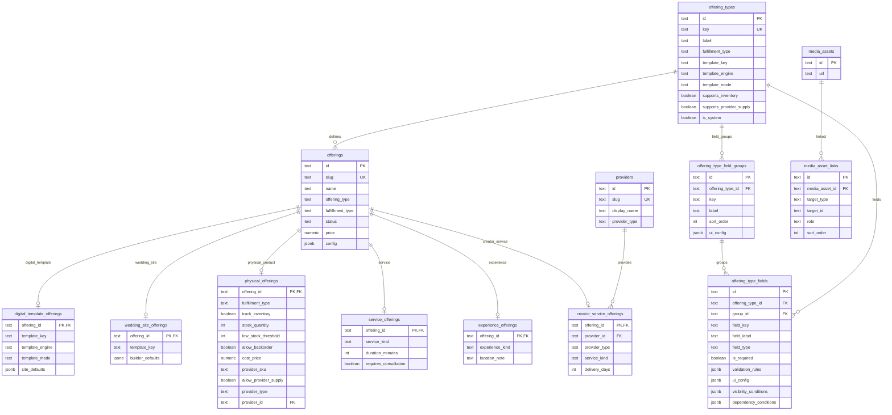
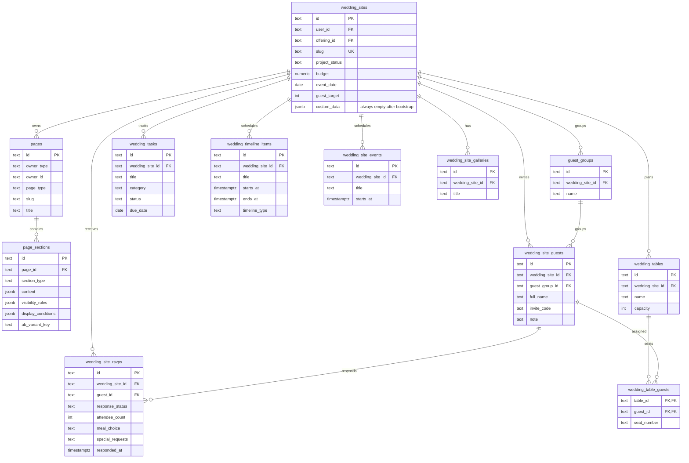
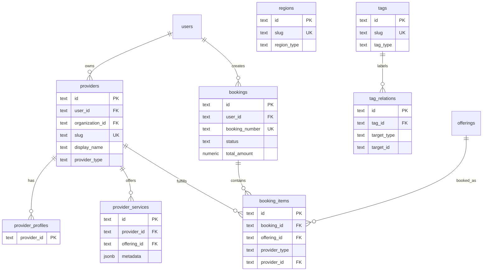
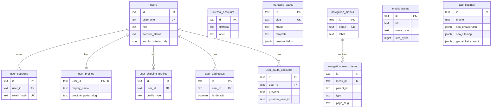
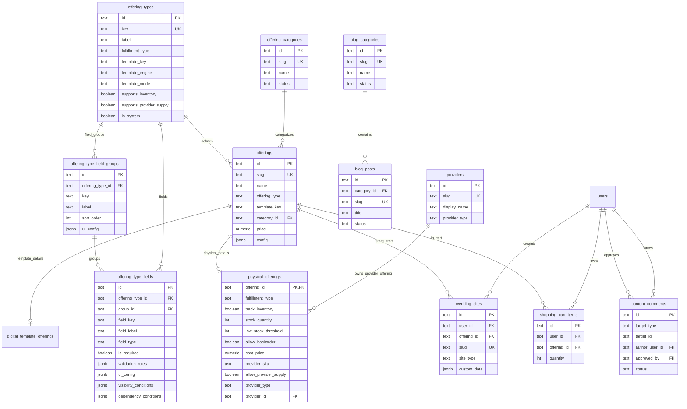
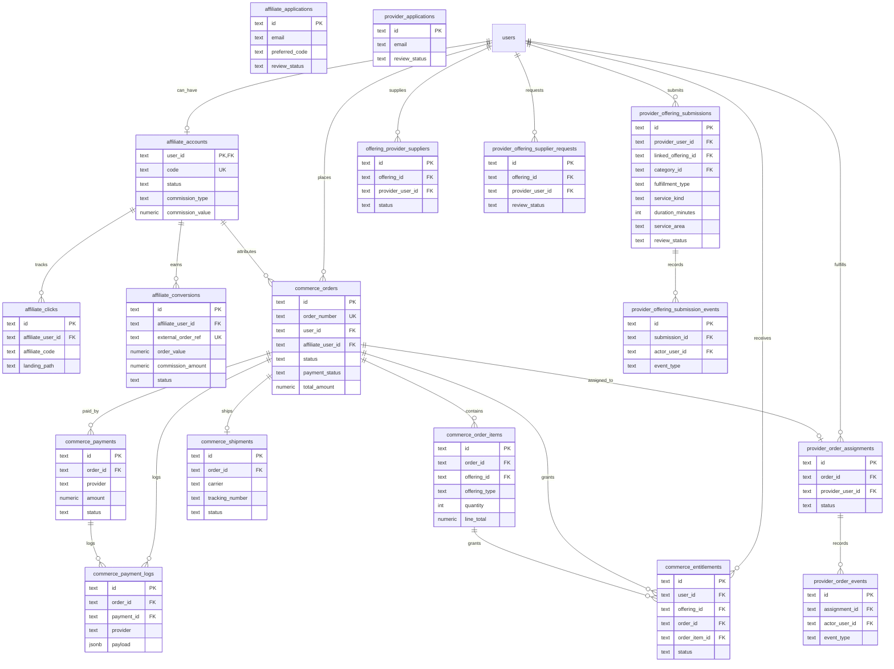
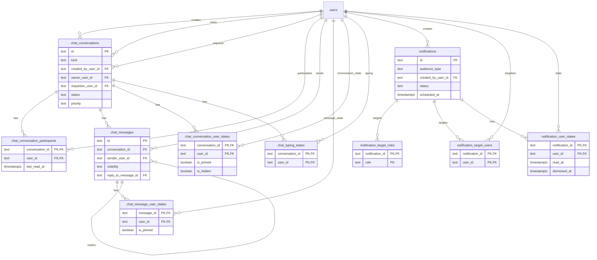

# Database Schema

Current database schema snapshot for the PinkLove project.

This file is meant to be readable directly on GitHub. GitHub renders the Mermaid
ER diagrams below, so the table map can be reviewed without opening a database
client.

Snapshot source:

- Runtime database: local Docker PostgreSQL `app`
- Schema source in code: `web/src/lib/database.ts`
- Last refreshed from DB: 2026-06-10

## ID Policy

The clean runtime schema uses `text` primary keys and foreign keys. The current
ID generator is `app_random_id()`, a nanoid-compatible 24 character text
generator. The latest DB audit returned zero `bigint`/`integer` ID columns.

## Table Count

Target runtime database has 123 public tables after the simplified Admin RBAC
refactor:

| Area | Tables |
| --- | --- |
| Identity and Admin access | `users`, `user_sessions`, `user_profiles`, `user_shipping_profiles`, `user_addresses`, `user_oauth_accounts`, `internal_accounts`, `admin_roles`, `admin_permissions`, `admin_role_permissions` |
| CMS | `managed_pages`, `navigation_menus`, `navigation_menu_items`, `app_settings` |
| Website builder | `pages`, `page_sections` |
| Media | `media_assets`, `media_asset_links`, `media_collections`, `media_collection_items` |
| Affiliate | `affiliate_accounts`, `affiliate_clicks`, `affiliate_conversions`, `affiliate_applications` |
| Offerings | `offering_types`, `offering_type_field_groups`, `offering_type_fields`, `offering_categories`, `offerings`, `offering_bundles`, `offering_bundle_items`, `offering_relationships`, `offering_search_documents`, `shopping_cart_items` |
| Blog / comments | `blog_categories`, `blog_posts`, `content_comments` |
| Commerce | `commerce_orders`, `commerce_order_items`, `commerce_payments`, `commerce_payment_logs`, `commerce_shipments`, `commerce_entitlements` |
| Landing / campaigns | `landing_pages`, `landing_page_sections`, `campaigns`, `campaign_stats`, `ab_experiments`, `ab_experiment_landing_pages` |
| Ads / provider priority | `advertisers`, `ad_placements`, `ad_campaigns`, `ad_creatives`, `ad_events`, `provider_promotion_plans`, `provider_promotions`, `provider_promotion_events` |
| Providers | `provider_order_assignments`, `provider_order_events`, `provider_offering_submissions`, `provider_offering_submission_events`, `offering_provider_suppliers`, `provider_offering_supplier_requests`, `provider_applications` |
| Chat | `chat_conversations`, `chat_conversation_participants`, `chat_messages`, `chat_message_user_states`, `chat_conversation_user_states`, `chat_typing_states` |
| Notifications | `notifications`, `notification_target_roles`, `notification_target_users`, `notification_user_states` |
| Offering domain extensions | `digital_template_offerings`, `physical_offerings`, `wedding_site_offerings`, `service_offerings`, `creator_service_offerings`, `experience_offerings` |
| Wedding planning | `wedding_sites`, `guest_groups`, `wedding_site_guests`, `wedding_site_rsvps`, `wedding_tables`, `wedding_table_guests`, `wedding_tasks`, `wedding_timeline_items`, `wedding_site_events`, `wedding_site_galleries` |
| Provider ecosystem | `providers`, `provider_profiles`, `provider_services`, `provider_regions`, `provider_reviews`, `provider_pricing`, `provider_fulfillments`, `provider_types`, `vendor_leads`, `vendor_quotes`, `provider_search_documents` |
| Service booking | `bookings`, `booking_items`, `booking_status_logs`, `booking_payments`, `booking_calendars`, `provider_availability`, `provider_time_slots` |
| Organizations | `organizations`, `organization_members`, `organization_roles` |
| Template attributes / engines | `template_attributes`, `template_attribute_values`, `template_engines` |
| Taxonomy / events / analytics / regions | `tags`, `tag_relations`, `domain_events`, `domain_event_types`, `analytics_sessions`, `analytics_page_views`, `analytics_events`, `conversion_goals`, `conversion_events`, `regions`, `shipping_regions`, `service_regions` |
| System config / constraints | `offering_statuses`, `media_target_types`, `media_roles` |
| SEO / audit | `seo_redirects`, `field_change_logs` |

## Core Refactor Status

The sellable catalog source of truth is `offerings`. The older product naming
has been removed from the application surface and new catalog work should not
create `products` tables, routes, services, or API names.

The architecture overview lives in `docs/architecture.md`. This document tracks
the implemented runtime schema only. Proposed tables do not belong here.

`web/scripts/audit-schema.mjs` locks the exact 123-table public inventory,
required architecture columns, foreign-key integrity, and forbidden legacy
tables. A migration is complete only when the audit passes against both the
current database and a newly created empty database.

Ads placement types include `banner`, `provider_listing`, `offering_listing`,
`mixed`, `popup`, `floating`, and `announcement`. Popup/floating/announcement
display rules live in ads metadata and are rendered through one centralized
public guest ads host.

Admin access is intentionally minimal:

- `users.role = 'ADMIN'` selects the Admin portal.
- `users.admin_role_id` selects one active role.
- `admin_role_permissions` grants database-managed module permissions.
- `super_admin` bypasses individual permission rows.
- Staff profiles, remote work, time tracking, leave, recruitment, contracts,
  and payroll are outside this application.

Offering types are data-driven through `offering_types`:

- `offerings.offering_type` stores the type key.
- `offering_types.key` defines available type keys, labels, fulfillment behavior,
  and inventory/provider flags.
- `offering_types.is_default` marks types prioritized by default in Admin offering workflows.
- Relational `offering_type_fields` rows are the source of truth for admin field
  definitions.
- `offering_types.status` has been removed; type availability is controlled by
  code registration.
- `offering_types.field_schema` has been removed from the clean runtime schema.
- Custom type-specific values are stored under `offerings.config.customFields`.
- `offerings.config` is guarded as lightweight UI/metadata storage only. The
  database boundary rejects `inventory`, `pricing_rules`, `permissions`,
  `analytics`, `booking_logic`, `relational_data`, `siteDefaults`,
  `generalOffering` and legacy config supply key.
- `offerings.config` also has a soft size guard: `pg_column_size(config) <=
  32768`, so it cannot become a dumping ground.
- Physical inventory, cost, provider ownership, and provider supply flags live in
  `physical_offerings`, not in `offerings.config`.
- New offering types must be registered in
  `src/features/offerings/type-registry.ts` together with their frontend
  renderer contract. `/admin/offerings/types` only edits relational fields.
- Add a dedicated subtype table only when a domain needs strongly queried,
  relational columns at scale.

Runtime now uses business-domain offering tables for active catalog modeling.
The transitional `physical_product_offerings` table has been migrated into
`physical_offerings` and removed. Coded/builder behavior is stored as rendering
strategy through `template_engine` and `template_mode`, not as product type.

Current domain tables:

- `digital_template_offerings`
- `physical_offerings`
- `wedding_site_offerings`
- `service_offerings`
- `creator_service_offerings`
- `experience_offerings`

Current system offering type keys:

- `digital_template`
- `physical_product`
- `wedding_decoration`
- `wedding_gift`
- `wedding_photo`
- `wedding_planner`
- `wedding_service`
- `wedding_video`

Database bootstrap upserts code-registered offering type metadata and deletes
unregistered types and corresponding offerings.

Field definitions are relational `offering_type_fields` rows grouped by
`offering_type_field_groups`. Admin offering create/edit forms read these rows
directly, render grouped dynamic field sections, apply visibility conditions,
and validate custom values before writing `offerings.config.customFields`.

The clean schema includes the provider, bundle, availability, search document,
organization, domain event, template attribute, and analytics tables from the
final architecture checklist.

Config tables seed controlled values for `provider_types`, `template_engines`,
`offering_statuses`, `media_target_types`, `media_roles`, and
`domain_event_types`. This keeps admin forms extensible without allowing random
provider types, media targets, media roles, template engines, or cache
invalidation event names.

Current runtime seed data:

| Type key | Label | Status | Fulfillment | Template key | Inventory | Provider supply | System | Fields |
| --- | --- | --- | --- | --- | --- | --- | --- | ---: |
| `physical_product` | Thiệp giấy | active | physical | `physical_product` | yes | yes | yes | 0 |
| `wedding_gift` | Quà cưới | active | physical | `wedding_gift` | yes | yes | yes | 0 |
| `wedding_photo` | Chụp ảnh cưới | active | service | `wedding_photo` | no | yes | yes | 0 |
| `wedding_video` | Làm video cưới | active | service | `wedding_video` | no | yes | yes | 0 |
| `wedding_decoration` | Trang trí tiệc cưới | active | service | `wedding_decoration` | no | yes | yes | 0 |
| `wedding_planner` | Wedding planner | active | service | `wedding_planner` | no | yes | yes | 0 |
| `wedding_service` | Dịch vụ cưới | active | service | `wedding_service` | no | yes | yes | 0 |

Current runtime offering data:

| Offering type | Template engine | Rows |
| --- | --- | ---: |
| `physical_product` | none | 1 |
| `wedding_photo` | none | 1 |
| `wedding_gift` | none | 1 |
| `wedding_video` | none | 1 |
| `wedding_decoration` | none | 1 |
| `wedding_planner` | none | 1 |
| `wedding_service` | none | 1 |

## Final Cleanup Runtime Contracts

- ID columns are text-only. User references, menu references, affiliate
  references, chat references, provider fulfillment references, and
  `app_settings.id` have all been migrated away from `bigint`/`integer` IDs.
- Provider types are controlled by `provider_types`; current seeded values are
  `supplier`, `creator`, `studio`, `planner`, `photographer`, `makeup`,
  `florist`, and `videographer`.
- Marketplace and provider ecosystem ownership resolves through `providers.id`.
  Current offering subtype tables that model provider ownership use
  `provider_id` plus `provider_type` against `providers.id`; account-bound
  fulfillment workflow tables use `provider_user_id` against `users.id`.
- Template rendering strategy is controlled by `template_engines`; current
  seeded values are `coded`, `builder`, `hybrid`, `motion`, `video`, and
  `ai_generated`.
- Offering moderation status is controlled by `offering_statuses`; current
  seeded values are `draft`, `pending_review`, `published`, `archived`, and
  `disabled`.
- Media link constraints are backed by `media_target_types` and `media_roles`.
  The runtime accepts targets such as `offering`, `supplier`, `wedding_site`,
  `gallery`, `booking`, `organization`, and `template`.
- `offering_search_documents.search_vector` is a generated PostgreSQL
  `tsvector` with a GIN index for full-text search.
- Search sync event names are registered in `domain_event_types`:
  `offering.search.sync`, `template.search.sync`, and `provider.search.sync`.
- Bundles support pricing rules through `pricing_strategy`, `discount_type`, and
  `discount_value`.
- `field_change_logs` stores auditable field changes across modules.
- `seo_redirects` holds redirect domain state outside generic JSON settings.
- Admin redirect management and runtime redirect lookup use `seo_redirects`;
  legacy `app_settings.seo_redirects` is only a fallback/backfill source.
- `domain_event_types` declares canonical event names and marks cache
  invalidation events such as `offering.updated`, `template.updated`,
  `provider.updated`, and `site.published`.
- Provider-prefixed fulfillment tables remain intentionally as the physical
  fulfillment domain and use `provider_user_id` where the app workflow is
  account-based. Provider-facing marketplace identity lives in `providers` and
  the provider ecosystem tables.

## Final Architecture Rules

Provider account workflow and provider marketplace identity are intentionally
separate. Use `providers.id` for marketplace identity, discovery, services,
profiles, booking, pricing, reviews, and public provider ecosystem data. Use
`users.id` only through explicitly named `provider_user_id` fields for
authentication, admin moderation, supplier account workflow, and operational
fulfillment screens where the actor is a provider user account. `provider_id`
is reserved for `providers.id`; `providers.owner_user_id` stores the auth owner
of a provider entity.

`physical_offerings` is the only physical subtype table. It stores inventory,
cost, provider SKU, provider supply flags, and optional `provider_id` /
`provider_type`. The removed `owner_type` semantics are now derived from
whether `provider_id` is present.

Template key ownership is strict:

- `offering_types.template_key` is the system preset key for a type.
- `offerings.template_key` is the actual runtime selected template for the
  sellable offering.
- Subtype `template_key` columns are allowed only when rendering/runtime needs a
  subtype-local template identity.

`template_engine` controls rendering, runtime, and editor behavior only. It does
not control business logic, commerce behavior, pricing, permissions, inventory,
or fulfillment.

Dynamic fields are limited to UI metadata, presentation, discovery, and optional
structured fields. Payments, permissions, inventory, critical business
workflows, analytics, and booking core logic must stay relational-first.

Availability is split intentionally:

- `booking_calendars` is the provider-owned calendar container and can be
  distinguished by `key`, `label`, `timezone`, and `config`.
- `provider_availability` stores recurring weekly rules declared by providers.
  Provider-facing rules must link to an approved service via `offering_id` or `provider_service_id` and
  classify the operational purpose with `availability_kind` (`general`,
  `consultation`, `on_site_service`, `provider_site_service`, `handoff`,
  `production`).
- `provider_time_slots` stores concrete dated slots for booking workflows and
  should carry `availability_id`, `provider_service_id`, `offering_id`, and
  `availability_kind` when generated from declared availability.
- Calendar provider category is derived from `providers.provider_type`; do not
  add a separate calendar type for provider categories unless a new booking
  domain requires a relationally queried classification.
- `offerings.fulfillment_type` is handoff/commerce behavior (`digital`,
  `physical`, `service`), not enough to identify what a calendar slot is for.
  Use `availability_kind` plus service/offering linkage for makeup-at-location,
  studio service, consultation, handoff, and production scheduling.
- Provider service requests store `service_kind`, `duration_minutes`, and
  `service_area` on `provider_offering_submissions`. When a service request is
  approved, these values are applied into `service_offerings` and
  `provider_services.metadata`.

## Overview

```mermaid
erDiagram
  users ||--o{ user_sessions : owns
  users ||--o{ user_profiles : has
  users ||--o{ wedding_sites : creates
  users ||--o{ commerce_orders : places
  users ||--o| affiliate_accounts : can_have
  users ||--o{ chat_conversations : participates
  users ||--o{ notifications : receives

  offering_categories ||--o{ offerings : categorizes
  offering_types ||--o{ offerings : defines
  offering_types ||--o{ offering_type_field_groups : field_groups
  offering_types ||--o{ offering_type_fields : fields
  offering_type_field_groups ||--o{ offering_type_fields : groups
  offerings ||--o| digital_template_offerings : has
  offerings ||--o| wedding_site_offerings : has
  offerings ||--o| physical_offerings : has
  offerings ||--o| service_offerings : has
  offerings ||--o| creator_service_offerings : has
  offerings ||--o| experience_offerings : has
  offerings ||--o{ media_asset_links : media
  offerings ||--o{ wedding_sites : creates
  offerings ||--o{ commerce_order_items : sold_as

  commerce_orders ||--o{ commerce_order_items : contains
  commerce_orders ||--o{ commerce_payments : paid_by
  commerce_orders ||--o{ commerce_entitlements : grants
  commerce_orders ||--o| provider_order_assignments : assigned_to

  navigation_menus ||--o{ navigation_menu_items : contains
  blog_categories ||--o{ blog_posts : contains
  chat_conversations ||--o{ chat_messages : has
  notifications ||--o{ notification_user_states : has
```



## Offerings Core



## Wedding Planning And Website Builder



Invitation runtime data is persisted through `page_sections` with
`owner_type = wedding_site` and `section_type = template_data`.
`wedding_sites.custom_data` is no longer a write
target; bootstrap clears old values and runtime create/update paths keep it as
`{}`. Structured arrays in template data are also synced into
`wedding_site_events`, `wedding_site_guests`, and `wedding_site_rsvps` when
present.

## Ecosystem Extensions



## Identity And CMS



## Offering, Catalog, And Public Content



## Commerce, Affiliate, And Provider Flow



## Chat And Notifications



## Runtime Foreign Key List

This list covers all runtime database-level foreign keys.
`offering_types.key` is intentionally referenced by application logic rather
than a hard FK so type definitions can be managed as configuration data and
archived without breaking existing catalog rows.

| From | To | On delete |
| --- | --- | --- |
| `affiliate_accounts.approved_by` | `users.id` | SET NULL |
| `affiliate_accounts.user_id` | `users.id` | CASCADE |
| `affiliate_clicks.affiliate_user_id` | `affiliate_accounts.user_id` | CASCADE |
| `affiliate_conversions.affiliate_user_id` | `affiliate_accounts.user_id` | CASCADE |
| `analytics_events.page_view_id` | `analytics_page_views.id` | SET NULL |
| `analytics_events.session_id` | `analytics_sessions.id` | SET NULL |
| `analytics_page_views.session_id` | `analytics_sessions.id` | SET NULL |
| `analytics_sessions.user_id` | `users.id` | SET NULL |
| `blog_posts.category_id` | `blog_categories.id` | CASCADE |
| `booking_calendars.provider_id` | `providers.id` | CASCADE |
| `booking_items.booking_id` | `bookings.id` | CASCADE |
| `booking_items.offering_id` | `offerings.id` | SET NULL |
| `booking_items.provider_id` | `providers.id` | SET NULL |
| `booking_payments.booking_id` | `bookings.id` | CASCADE |
| `booking_status_logs.actor_user_id` | `users.id` | SET NULL |
| `booking_status_logs.booking_id` | `bookings.id` | CASCADE |
| `bookings.user_id` | `users.id` | SET NULL |
| `chat_conversation_participants.conversation_id` | `chat_conversations.id` | CASCADE |
| `chat_conversation_participants.user_id` | `users.id` | CASCADE |
| `chat_conversation_user_states.conversation_id` | `chat_conversations.id` | CASCADE |
| `chat_conversation_user_states.user_id` | `users.id` | CASCADE |
| `chat_conversations.created_by_user_id` | `users.id` | SET NULL |
| `chat_conversations.owner_user_id` | `users.id` | SET NULL |
| `chat_conversations.requester_user_id` | `users.id` | SET NULL |
| `chat_message_user_states.message_id` | `chat_messages.id` | CASCADE |
| `chat_message_user_states.user_id` | `users.id` | CASCADE |
| `chat_messages.conversation_id` | `chat_conversations.id` | CASCADE |
| `chat_messages.reply_to_message_id` | `chat_messages.id` | SET NULL |
| `chat_messages.sender_user_id` | `users.id` | CASCADE |
| `chat_typing_states.conversation_id` | `chat_conversations.id` | CASCADE |
| `chat_typing_states.user_id` | `users.id` | CASCADE |
| `commerce_entitlements.order_id` | `commerce_orders.id` | CASCADE |
| `commerce_entitlements.order_item_id` | `commerce_order_items.id` | SET NULL |
| `commerce_entitlements.offering_id` | `offerings.id` | CASCADE |
| `commerce_entitlements.user_id` | `users.id` | CASCADE |
| `commerce_order_items.order_id` | `commerce_orders.id` | CASCADE |
| `commerce_order_items.offering_id` | `offerings.id` | SET NULL |
| `commerce_orders.affiliate_user_id` | `affiliate_accounts.user_id` | SET NULL |
| `commerce_orders.user_id` | `users.id` | CASCADE |
| `commerce_payment_logs.order_id` | `commerce_orders.id` | SET NULL |
| `commerce_payment_logs.payment_id` | `commerce_payments.id` | SET NULL |
| `commerce_payments.order_id` | `commerce_orders.id` | CASCADE |
| `commerce_shipments.order_id` | `commerce_orders.id` | CASCADE |
| `content_comments.approved_by` | `users.id` | SET NULL |
| `content_comments.author_user_id` | `users.id` | SET NULL |
| `creator_service_offerings.offering_id` | `offerings.id` | CASCADE |
| `creator_service_offerings.provider_id` | `providers.id` | SET NULL |
| `digital_template_offerings.offering_id` | `offerings.id` | CASCADE |
| `experience_offerings.offering_id` | `offerings.id` | CASCADE |
| `field_change_logs.actor_id` | `users.id` | SET NULL |
| `media_asset_links.media_asset_id` | `media_assets.id` | CASCADE |
| `physical_offerings.offering_id` | `offerings.id` | CASCADE |
| `physical_offerings.provider_id` | `providers.id` | SET NULL |
| `navigation_menu_items.menu_id` | `navigation_menus.id` | CASCADE |
| `notification_target_roles.notification_id` | `notifications.id` | CASCADE |
| `notification_target_users.notification_id` | `notifications.id` | CASCADE |
| `notification_target_users.user_id` | `users.id` | CASCADE |
| `notification_user_states.notification_id` | `notifications.id` | CASCADE |
| `notification_user_states.user_id` | `users.id` | CASCADE |
| `notifications.created_by_user_id` | `users.id` | SET NULL |
| `offering_bundle_items.bundle_id` | `offering_bundles.id` | CASCADE |
| `offering_bundle_items.offering_id` | `offerings.id` | CASCADE |
| `offering_relationships.source_offering_id` | `offerings.id` | CASCADE |
| `offering_relationships.target_offering_id` | `offerings.id` | CASCADE |
| `offering_provider_suppliers.approved_by` | `users.id` | SET NULL |
| `offering_provider_suppliers.offering_id` | `offerings.id` | CASCADE |
| `offering_provider_suppliers.provider_user_id` | `users.id` | CASCADE |
| `offering_search_documents.offering_id` | `offerings.id` | CASCADE |
| `offering_type_field_groups.offering_type_id` | `offering_types.id` | CASCADE |
| `offering_type_fields.group_id` | `offering_type_field_groups.id` | SET NULL |
| `offering_type_fields.offering_type_id` | `offering_types.id` | CASCADE |
| `offerings.category_id` | `offering_categories.id` | SET NULL |
| `organization_members.organization_id` | `organizations.id` | CASCADE |
| `organization_members.role_id` | `organization_roles.id` | SET NULL |
| `organization_members.user_id` | `users.id` | CASCADE |
| `organizations.owner_user_id` | `users.id` | SET NULL |
| `organization_roles.organization_id` | `organizations.id` | CASCADE |
| `provider_availability.calendar_id` | `booking_calendars.id` | CASCADE |
| `provider_availability.provider_id` | `providers.id` | CASCADE |
| `provider_fulfillments.offering_id` | `offerings.id` | SET NULL |
| `provider_fulfillments.provider_id` | `providers.id` | CASCADE |
| `provider_pricing.offering_id` | `offerings.id` | CASCADE |
| `provider_pricing.provider_id` | `providers.id` | CASCADE |
| `provider_profiles.provider_id` | `providers.id` | CASCADE |
| `provider_regions.provider_id` | `providers.id` | CASCADE |
| `provider_regions.region_id` | `regions.id` | CASCADE |
| `provider_reviews.provider_id` | `providers.id` | CASCADE |
| `provider_reviews.user_id` | `users.id` | SET NULL |
| `provider_services.offering_id` | `offerings.id` | SET NULL |
| `provider_services.provider_id` | `providers.id` | CASCADE |
| `provider_time_slots.calendar_id` | `booking_calendars.id` | CASCADE |
| `provider_time_slots.offering_id` | `offerings.id` | SET NULL |
| `provider_time_slots.provider_id` | `providers.id` | CASCADE |
| `providers.organization_id` | `organizations.id` | SET NULL |
| `providers.owner_user_id` | `users.id` | SET NULL |
| `regions.parent_id` | `regions.id` | SET NULL |
| `service_offerings.offering_id` | `offerings.id` | CASCADE |
| `service_regions.offering_id` | `offerings.id` | CASCADE |
| `service_regions.region_id` | `regions.id` | CASCADE |
| `shipping_regions.region_id` | `regions.id` | CASCADE |
| `shopping_cart_items.offering_id` | `offerings.id` | CASCADE |
| `shopping_cart_items.user_id` | `users.id` | CASCADE |
| `tag_relations.tag_id` | `tags.id` | CASCADE |
| `template_attribute_values.attribute_id` | `template_attributes.id` | CASCADE |
| `template_attribute_values.offering_id` | `offerings.id` | CASCADE |
| `user_addresses.user_id` | `users.id` | CASCADE |
| `user_oauth_accounts.user_id` | `users.id` | CASCADE |
| `user_profiles.user_id` | `users.id` | CASCADE |
| `user_sessions.user_id` | `users.id` | CASCADE |
| `user_shipping_profiles.user_id` | `users.id` | CASCADE |
| `users.account_status_updated_by` | `users.id` | SET NULL |
| `provider_order_assignments.order_id` | `commerce_orders.id` | CASCADE |
| `provider_order_assignments.provider_user_id` | `users.id` | CASCADE |
| `provider_order_events.actor_user_id` | `users.id` | SET NULL |
| `provider_order_events.assignment_id` | `provider_order_assignments.id` | CASCADE |
| `provider_offering_submission_events.actor_user_id` | `users.id` | SET NULL |
| `provider_offering_submission_events.submission_id` | `provider_offering_submissions.id` | CASCADE |
| `provider_offering_submissions.category_id` | `offering_categories.id` | SET NULL |
| `provider_offering_submissions.linked_offering_id` | `offerings.id` | SET NULL |
| `provider_offering_submissions.reviewed_by` | `users.id` | SET NULL |
| `provider_offering_submissions.provider_user_id` | `users.id` | CASCADE |
| `provider_offering_supplier_requests.offering_id` | `offerings.id` | CASCADE |
| `provider_offering_supplier_requests.reviewed_by` | `users.id` | SET NULL |
| `provider_offering_supplier_requests.provider_user_id` | `users.id` | CASCADE |
| `guest_groups.wedding_site_id` | `wedding_sites.id` | CASCADE |
| `page_sections.page_id` | `pages.id` | CASCADE |
| `pages.owner_id` | polymorphic owner id | app-enforced |
| `vendor_leads.offering_id` | `offerings.id` | SET NULL |
| `vendor_leads.provider_id` | `providers.id` | CASCADE |
| `vendor_leads.user_id` | `users.id` | SET NULL |
| `vendor_quotes.lead_id` | `vendor_leads.id` | CASCADE |
| `vendor_quotes.provider_id` | `providers.id` | CASCADE |
| `provider_search_documents.provider_id` | `providers.id` | CASCADE |
| `media_collection_items.collection_id` | `media_collections.id` | CASCADE |
| `media_collection_items.media_asset_id` | `media_assets.id` | CASCADE |
| `conversion_events.goal_id` | `conversion_goals.id` | CASCADE |
| `conversion_events.session_id` | `analytics_sessions.id` | SET NULL |
| `conversion_events.user_id` | `users.id` | SET NULL |
| `wedding_site_events.wedding_site_id` | `wedding_sites.id` | CASCADE |
| `wedding_site_galleries.wedding_site_id` | `wedding_sites.id` | CASCADE |
| `wedding_site_guests.guest_group_id` | `guest_groups.id` | SET NULL |
| `wedding_site_guests.wedding_site_id` | `wedding_sites.id` | CASCADE |
| `wedding_site_offerings.offering_id` | `offerings.id` | CASCADE |
| `wedding_site_rsvps.guest_id` | `wedding_site_guests.id` | SET NULL |
| `wedding_site_rsvps.wedding_site_id` | `wedding_sites.id` | CASCADE |
| `wedding_table_guests.guest_id` | `wedding_site_guests.id` | CASCADE |
| `wedding_table_guests.table_id` | `wedding_tables.id` | CASCADE |
| `wedding_tables.wedding_site_id` | `wedding_sites.id` | CASCADE |
| `wedding_tasks.wedding_site_id` | `wedding_sites.id` | CASCADE |
| `wedding_timeline_items.wedding_site_id` | `wedding_sites.id` | CASCADE |
| `wedding_sites.offering_id` | `offerings.id` | SET NULL |
| `wedding_sites.user_id` | `users.id` | CASCADE |

## Refresh Commands

Use these commands when the runtime DB changes and this document needs a manual
refresh:

```bash
docker compose exec db psql -U app -d app -P pager=off -c \
  "select table_name from information_schema.tables where table_schema='public' and table_type='BASE TABLE' order by table_name;"

docker compose exec db psql -U app -d app -P pager=off -c \
  "select tc.table_name, kcu.column_name, ccu.table_name as foreign_table_name, ccu.column_name as foreign_column_name, rc.delete_rule from information_schema.table_constraints tc join information_schema.key_column_usage kcu on tc.constraint_name=kcu.constraint_name and tc.table_schema=kcu.table_schema join information_schema.constraint_column_usage ccu on ccu.constraint_name=tc.constraint_name and ccu.table_schema=tc.table_schema join information_schema.referential_constraints rc on rc.constraint_name=tc.constraint_name and rc.constraint_schema=tc.table_schema where tc.constraint_type='FOREIGN KEY' and tc.table_schema='public' order by tc.table_name,kcu.column_name;"

docker compose exec db psql -U app -d app -P pager=off -c \
  "select ot.key,ot.label,ot.fulfillment_type,ot.template_key,ot.supports_inventory,ot.supports_provider_supply,ot.is_system,count(otf.id) as fields from offering_types ot left join offering_type_fields otf on otf.offering_type_id=ot.id group by ot.id,ot.key,ot.label,ot.fulfillment_type,ot.template_key,ot.supports_inventory,ot.supports_provider_supply,ot.is_system order by ot.is_system desc, ot.key;"

docker compose exec db psql -U app -d app -P pager=off -c \
  "select offering_type,count(*) from offerings group by offering_type order by offering_type;"
```
